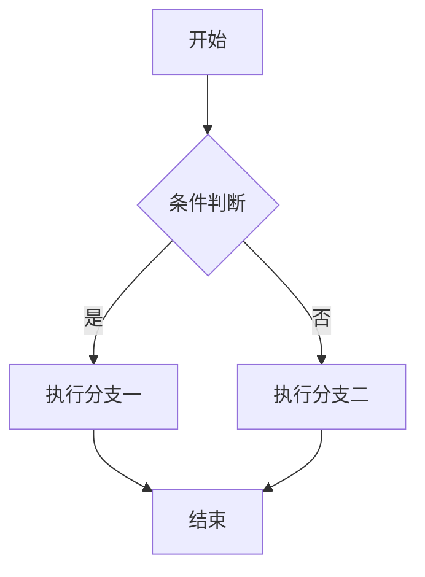
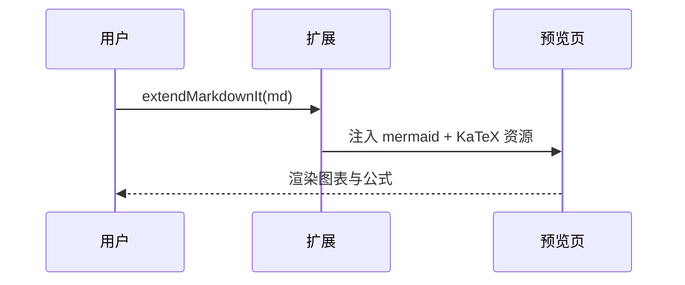
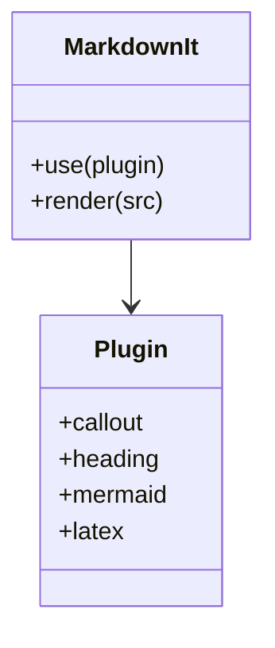

> 这是一份覆盖本插件全部扩展语法的示例文档，用 `Ctrl+Shift+V` 打开预览即可看到效果。

[toc]

# 第一章 开始使用

这是普通段落，里面有行内公式 $E = mc^2$、行内代码 `const a = 1` 和一个链接 [VSCode](https://code.visualstudio.com)。

## 第一章的第一节

块级公式会居中显示：

$$
\int_{0}^{1} x^{2}\,\mathrm{d}x = \frac{1}{3}
$$

矩阵、对齐、希腊字母都支持：

$$
\mathbf{A} = \begin{pmatrix} \alpha & \beta \\ \gamma & \delta \end{pmatrix}
$$

### 更深一层的小节

标题编号会自动跟随层级变化，跳级时会自动跳过前导的 0。

#### 第四级标题

##### 第五级标题

###### 第六级标题

## 第一章的第二节

下面是 Mermaid 图表：



时序图同样可以：



# 第二章 语法速查

## 提示框

```js
// # 这是注释，代码块里的 # 不会被当成标题、也不会被编号
function hello() {
  return 'hello';
}
```

五种最常用的类型，写法和 Obsidian 完全一致：

> [!NOTE]
> 没有写标题时，会使用该类型的默认标题。

> [!WARNING]
> 警告类提示框，适合写「可能导致数据丢失」这类内容。

> [!TIP]
> 小技巧提示框。

> [!DANGER]
> 危险提示框。

> [!ATTENTION]
> attention 适合写需要读者特别留意的内容。

其余内置类型与别名：

> [!TODO] 待办清单
> - [x] 已完成的事项
> - [ ] 待办的事项

> [!INFO]
> `info` 会归一到 `note`。

> [!CAUTION]
> `caution` 会归一到 `warning`，所以默认标题显示为「警告」。

> [!IMPORTANT]
> `important` 会归一到 `tip`，和 Obsidian 的别名表保持一致。

> [!BUG]
> `bug`、`error`、`failure`、`missing` 都会归一到 `danger`。

提示框内部支持完整的 Markdown，包括列表、表格、代码块，甚至嵌套：

> [!NOTE] 外层提示框
> 外层内容，下面是嵌套的内层提示框：
>
> > [!TIP] 内层提示框
> > 嵌套的提示框只要正确加上一层 `>` 前缀就能解析。
>
> | 能力 | 是否支持 |
> | --- | --- |
> | 列表 / 表格 / 代码块 | 是 |
> | 嵌套提示框 | 是 |
> | 行内公式 $a^2+b^2=c^2$ | 是 |

图表、公式、代码块都能放进提示框里：

> [!EXAMPLE] 提示框里的 Mermaid
> 图表的代码块继续加 `>` 前缀即可：
>
> ```mermaid
> graph LR
>   A[写文档] --> B{预览}
>   B -->|通过| C[提交]
>   B -->|不通过| A
> ```
>
> 行内公式 $a^2 + b^2 = c^2$ 也没问题。

## 提示框属性速查

Obsidian 的元数据槽位写在类型名后面的 `|` 里，多个用空格分隔：

> [!SUCCESS|color:green icon:🚀] 部署前检查
> - `color:green` 或 `color:#22c55e` 换强调色，也支持 `purple` 这种裸颜色名
> - `icon:🚀` 自定义图标（emoji 或任意文字）
> - `icon:none` 或 `no-icon` 隐藏图标
> - `collapsible`（等价 `fold`）让提示框可折叠
> - `open` / `closed` 指定默认展开还是折叠
> - `type:example` 临时借用其它类型的配色与图标
> - 不认识的词会变成 `mdext-admonition--meta-<名字>` 类名，方便自己写样式

折叠标记写在 `]` 的右边，`+` 默认展开、`-` 默认折叠：

> [!TIP]+ 默认展开的提示框
> 点标题栏可以收起来。

> [!EXAMPLE]- 默认折叠的提示框
> 点标题栏可以展开。

> [!EXAMPLE|closed] 用元数据指定默认折叠
> 效果和 `-` 一样。

> [!DANGER|color:#ff5722] 自定义强调色
> 强调色同时作用于左边框和标题栏底色。

> [!QUESTION|type:example color:pink] 临时覆盖类型
> 元数据里的 `type:` / `kind:` 优先级高于方括号里的类型名。

> [!WARNING|purple meta-demo] 通用元数据
> 这个提示框会同时带上 `mdext-admonition--meta-purple` 和 `mdext-admonition--meta-meta-demo` 两个类名。

### 兼容旧语法（可选）

旧的自定义语法仍然可用（可用 `markdownExtended.admonition.legacyBangSyntax` 关掉）：

!!!note{旧语法}
旧的 `!!!type{标题}` 写法，样式与 Obsidian 语法完全一致。
!!!

!!!danger{open=false collapsible}
旧语法里用 `{}` 传属性。
!!!

## 标题编号

编号规则：

- 只对 `startLevel` ~ `maxLevel` 之间的标题编号（默认 1~6 全部编号）
- 遇到更深层级会重新计数，回到浅层继续递增
- 分隔符可通过 `markdownExtended.headingNumber.separator` 改成 `-` 之类

## 目录

在任意位置单独写一行 `[toc]` 或 `[[toc]]` 就会生成目录树，链接可以直接跳到对应标题。

## Mermaid



代码块语言名写 `mermaid` 即可；也可以通过 `markdownExtended.mermaid.aliases` 增加 `mmd` 这类别名。
主题默认跟随 VSCode 亮 / 暗主题自动切换。

## LaTeX

行内 $a^2 + b^2 = c^2$，以及带上下标、分式、根号的 $\sum_{i=1}^{n} i = \frac{n(n+1)}{2}$、$\sqrt[3]{x}$。

块级公式带编号式写法（KaTeX 不生成自动编号，需要手动写 `\tag`）：

$$
e^{i\pi} + 1 = 0 \tag{1}
$$

## 任务列表与引用

- [x] 已完成的任务
- [ ] 待办的任务

> 普通引用块不会被误伤，只有紧跟 `[!类型]` 标记的引用块才会变成提示框。

# 第三章 附录

全文结束。标题 id 会自动生成锚点，中文标题同样可以跳转。


## 对话与 Chat 测试

使用 `::: chat` 容器呈现智能问答场景，用户气泡居右高亮显示，AI 气泡居左并支持富文本内联排版：

::: chat
用户: 你好，请帮我分析一下 GoldenEdit 的架构优势。
AI: GoldenEdit 采用 **Rust + Tauri 2** 架构，将 Monaco 源码编辑与独立沙箱的预览 iframe 分离，具备以下核心特性：
AI: 1. **零白屏容错**：任意单块渲染异常自动隔离为块内错误卡；
AI: 2. **增量 Diff**：使用 morphdom 局部更新，图表状态不丢失；
AI: 3. **统一颜色变量**：插件严格遵循 `--ge-*` CSS 规范，明暗主题无缝适配。
用户: 太棒了！那插件体系如何运行？
AI: 采用 ES Module 运行在 Web Worker 与主线程双环境中，兼具高性能解析与丰富的 DOM 挂载能力。
:::

使用 `::: dialogue` 容器呈现多人对话与剧本对白：

::: dialogue
旁白: 某软件研发团队正在召开版本发布评审会。
产品经理: 我们的 0.3.0 版本所有内置插件（Mermaid、KaTeX、Callout、Codebar、GFM Table 等）是否都已经就绪？
技术主管(右): 报告，所有 8 个内置插件全部完成并自包含在系统中，单测全部通过！
测试人员: 我刚刚用覆盖全语法的 `demo.md` 完成了端到端回归，渲染正常无任何报错。
产品经理: 很好，准予打包发布！
:::
